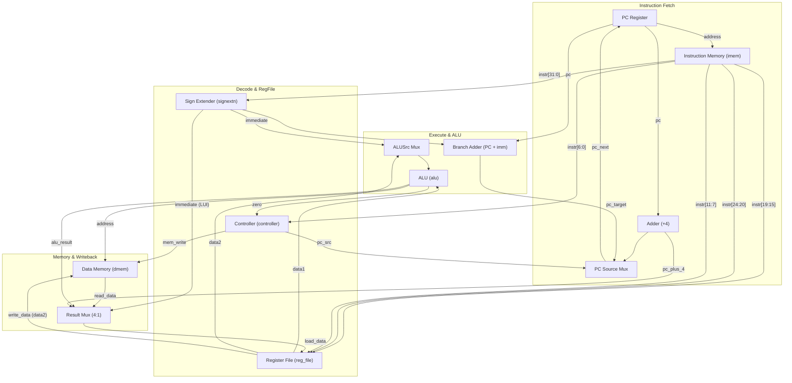
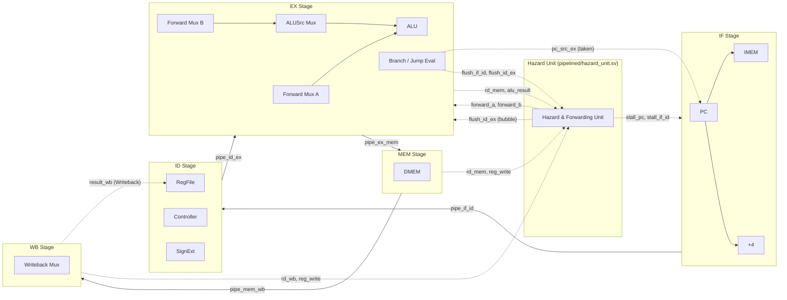

# RM32 — Single-Cycle & 5-Stage Pipelined RV32I Processor Core

[](https://github.com/nikunjmalik306/rm32/actions/workflows/ci.yml)
[](https://en.wikipedia.org/wiki/SystemVerilog)
[-orange.svg)](https://riscv.org/)
[-brightgreen.svg)]()
[]()
[](LICENSE)

---

## 1. Project Overview

**RM32** is a modular, verified 32-bit RISC-V processor core implemented in SystemVerilog conforming to the open-standard [RISC-V RV32I Unprivileged ISA](https://riscv.org/). The repository provides two complete, independent microarchitectures:
1. **Single-Cycle Datapath (`rtl/`):** Executes all supported instructions in 1 clock cycle ($\text{CPI} = 1.0$), featuring unified immediate sign-extension, ALU with zero flag, word-aligned memory interfaces, and embedded SystemVerilog Assertions (SVA).
2. **5-Stage Pipelined Core (`pipelined/`):** Implements a classic IF/ID/EX/MEM/WB pipeline equipped with full data forwarding (EX/MEM and MEM/WB to EX), 1-cycle load-use hazard stalling with bubble injection, branch resolution in the EX stage with 2-cycle speculative flush, and hardware performance counters.

The design is verified end-to-end using an open-source EDA toolchain (Icarus Verilog, Verilator, and Yosys), featuring self-checking unit testbenches, directed hazard tests, real assembly programs, and an independent Python Instruction Set Simulator (ISS) golden reference model with automated trace diff.

> [!NOTE]
> **Honesty & Verification Scope**:
> Every number, test result, and performance metric reported in this documentation is taken directly from real simulation logs and synthesis reports generated in this repository. All verification was conducted via behavioral simulation and generic logic synthesis. The design has **not** been placed and routed on physical FPGA or ASIC silicon.

---

## 2. Supported RV32I Instruction Subset

The core implements 15 foundational RV32I integer instructions spanning all major formats:

| Instruction | Type | Syntax | Opcode | Funct3 | Funct7 | Description |
|:---|:---:|:---|:---:|:---:|:---:|:---|
| **`lw`** | I | `lw rd, imm(rs1)` | `0000011` | `010` | — | Load 32-bit word from memory |
| **`sw`** | S | `sw rs2, imm(rs1)` | `0100011` | `010` | — | Store 32-bit word to memory |
| **`add`** | R | `add rd, rs1, rs2` | `0110011` | `000` | `0000000` | Arithmetic addition |
| **`sub`** | R | `sub rd, rs1, rs2` | `0110011` | `000` | `0100000` | Arithmetic subtraction |
| **`and`** | R | `and rd, rs1, rs2` | `0110011` | `111` | `0000000` | Bitwise logical AND |
| **`or`** | R | `or rd, rs1, rs2` | `0110011` | `110` | `0000000` | Bitwise logical OR |
| **`slt`** | R | `slt rd, rs1, rs2` | `0110011` | `010` | `0000000` | Set Less Than (signed comparison) |
| **`addi`** | I | `addi rd, rs1, imm` | `0010011` | `000` | — | Add immediate (sign-extended) |
| **`andi`** | I | `andi rd, rs1, imm` | `0010011` | `111` | — | Bitwise AND immediate |
| **`ori`** | I | `ori rd, rs1, imm` | `0010011` | `110` | — | Bitwise OR immediate |
| **`slti`** | I | `slti rd, rs1, imm` | `0010011` | `010` | — | Set Less Than immediate (signed) |
| **`beq`** | B | `beq rs1, rs2, label` | `1100011` | `000` | — | Branch if Equal (`rs1 == rs2`) |
| **`bne`** | B | `bne rs1, rs2, label` | `1100011` | `001` | — | Branch if Not Equal (`rs1 != rs2`) |
| **`jal`** | J | `jal rd, label` | `1101111` | — | — | Jump and Link (target = `PC + imm`, `rd = PC + 4`) |
| **`lui`** | U | `lui rd, imm` | `0110111` | — | — | Load Upper Immediate (`rd = imm << 12`) |

---

## 3. Microarchitectural Diagrams

### Single-Cycle Datapath (`rtl/datapath.sv`)



---

### 5-Stage Pipelined Architecture with Hazard Unit (`pipelined/`)



---

## 4. Control Unit Truth Tables

### Main Decoder

| Opcode | Instruction Class | `reg_write` | `imm_src[2:0]` | `alu_src` | `mem_write` | `result_src[1:0]` | `branch` | `jump` | `alu_op[1:0]` |
|:---:|:---:|:---:|:---:|:---:|:---:|:---:|:---:|:---:|:---:|
| `0000011` | `lw` | `1` | `000` (I) | `1` (imm) | `0` | `01` (dmem) | `0` | `0` | `00` (ADD) |
| `0100011` | `sw` | `0` | `001` (S) | `1` (imm) | `1` | `00` (X) | `0` | `0` | `00` (ADD) |
| `0110011` | R-type | `1` | `000` (X) | `0` (rs2) | `0` | `00` (alu) | `0` | `0` | `10` (R-type) |
| `0010011` | I-type ALU | `1` | `000` (I) | `1` (imm) | `0` | `00` (alu) | `0` | `0` | `10` (I-type) |
| `1100011` | Branch (`beq`/`bne`) | `0` | `010` (B) | `0` (rs2) | `0` | `00` (X) | `1` | `0` | `01` (SUB) |
| `1101111` | `jal` | `1` | `011` (J) | `0` (X) | `0` | `10` (PC+4)| `0` | `1` | `00` (ADD) |
| `0110111` | `lui` | `1` | `100` (U) | `1` (X) | `0` | `11` (imm) | `0` | `0` | `00` (ADD) |

### ALU Decoder

| `alu_op[1:0]` | `funct3[2:0]` | `op[5]` | `funct7[5]` | `alu_ctrl[2:0]` | ALU Operation | Instructions |
|:---:|:---:|:---:|:---:|:---:|:---:|:---|
| `00` | `---` | `-` | `-` | `000` | Addition (`a + b`) | `lw`, `sw`, `jal`, `lui` |
| `01` | `---` | `-` | `-` | `001` | Subtraction (`a - b`) | `beq`, `bne` |
| `10` | `000` | `1` | `1` | `001` | Subtraction (`a - b`) | `sub` |
| `10` | `000` | `0` or `x` | `0` | `000` | Addition (`a + b`) | `add`, `addi` |
| `10` | `010` | `-` | `-` | `101` | Signed Compare (`$signed(a) < $signed(b)`) | `slt`, `slti` |
| `10` | `110` | `-` | `-` | `011` | Bitwise OR (`a \| b`) | `or`, `ori` |
| `10` | `111` | `-` | `-` | `010` | Bitwise AND (`a & b`) | `and`, `andi` |

---

## 5. Immediate Encoding Formats

All immediate fields are sign-extended to 32 bits. In accordance with the RISC-V specification, bit 31 always drives the sign-extension replication bit:

```
I-type: [31:20]                                                 --> imm[11:0]
S-type: [31:25] | [11:7]                                        --> imm[11:0]
B-type: [31] | [7] | [30:25] | [11:8] | 1'b0                    --> imm[12:0]
J-type: [31] | [19:12] | [20] | [30:21] | 1'b0                  --> imm[20:0]
U-type: [31:12] | 12'b0                                         --> imm[31:0]
```

---

## 6. Memory Map & Addressing Rules

- **Word-Aligned Addressing:** All memory accesses (`imem` and `dmem`) enforce 4-byte alignment: `address[1:0] == 2'b00`.
- **Unaligned Access Behavior:**
  - Unaligned stores (`address[1:0] != 2'b00`) are ignored; memory contents are untouched.
  - Unaligned loads return `32'h00000000`.
- **Out-of-Bounds Behavior:**
  - Memory depth is parameterized (default: 128 words / 512 bytes).
  - Out-of-bounds instruction fetch returns `0x00000013` (NOP: `addi x0, x0, 0`), preventing simulation halts.
  - Out-of-bounds data writes are ignored; out-of-bounds data reads return `32'h00000000`.

---

## 7. Real Verification & Test Results

The full test suite executes automatically via `make test`. All results below are reproduced directly from the real simulation logs:

### Unit Test Suite (`tests/unit/`)

| Testbench | Module Under Test | Checks Run | Passes | Fails | Scope & Assertions Verified |
|:---|:---|:---:|:---:|:---:|:---|
| [`tb_alu.sv`](tests/unit/tb_alu.sv) | `alu` | 10 | **10** | 0 | ADD, SUB, AND, OR, SLT signed compare (-5 < 5), zero flag |
| [`tb_reg_file.sv`](tests/unit/tb_reg_file.sv) | `reg_file` | 5 | **5** | 0 | Dual read, synchronous write, x0 write suppression, reset |
| [`tb_signextn.sv`](tests/unit/tb_signextn.sv) | `signextn` | 8 | **8** | 0 | I, S, B, J, U formats; positive and negative sign extensions |
| [`tb_controller.sv`](tests/unit/tb_controller.sv) | `controller` | 17 | **17** | 0 | All 15 instructions decoded; BEQ/BNE taken & not-taken conditions |
| [`tb_dmem.sv`](tests/unit/tb_dmem.sv) | `dmem` | 6 | **6** | 0 | Synchronous write, combinational read, unaligned rejection, bounds |
| **Total Unit Checks** | | **46** | **46** | **0** | **100% PASS** |

### Integration & Real Program Suite

| Testbench | Target Architecture | Program / Hex | Checks | Result | Execution Details |
|:---|:---|:---|:---:|:---:|:---|
| [`tb_instruction_classes.sv`](tests/integration/tb_instruction_classes.sv) | Single-Cycle | `edge_cases.hex` | 15 | **PASS** | x0 invariant, SLT/SLTI signed logic, LUI, JAL link/jump, BEQ/BNE |
| [`tb_programs.sv`](tests/integration/tb_programs.sv) | Single-Cycle | `sum10.hex` | 3 | **PASS** | Loop $\sum_{i=1}^{10} i = 55$; writes to DMem[0], reloads to x3 |
| [`tb_programs.sv`](tests/integration/tb_programs.sv) | Single-Cycle | `mem_loop.hex` | 3 | **PASS** | Array store [10,20,30,40], loop sum=100; reloads to x7 |
| [`tb_pipeline_hazards.sv`](tests/pipelined/tb_pipeline_hazards.sv) | 5-Stage Pipeline | `hazard_tests.hex` | 9 | **PASS** | RAW forwarding, x0 suppression, load-use stall, branch flush |
| [`tb_pipeline_programs.sv`](tests/pipelined/tb_pipeline_programs.sv) | 5-Stage Pipeline | `sum10.hex` | 3 | **PASS** | Final sum x2=55, dmem[0]=55, x3=55; 56 cycles, 36 dynamic insts |
| [`tb_pipeline_programs.sv`](tests/pipelined/tb_pipeline_programs.sv) | 5-Stage Pipeline | `mem_loop.hex` | 3 | **PASS** | Final sum x5=100, dmem[4]=100, x7=100; 42 cycles, 29 dynamic insts |
| [`single_cycle_TB.sv`](TestBench/single_cycle_TB.sv) | Single-Cycle | Legacy Test | 2 | **PASS** | Original Vivado testbench updated for active-high reset |

### Golden Model Trace-Diff Verification (`tools/run_trace_diff.py`)

| Test Program | Golden Model (Python ISS) | RTL Simulation | Instructions Compared | Trace Mismatches | Status |
|:---|:---|:---|:---:|:---:|:---:|
| `sum10.hex` | `rv32i_iss.py` | Single-Cycle RTL | 60 instructions | 0 | **100% EXACT MATCH** |
| `mem_loop.hex` | `rv32i_iss.py` | Single-Cycle RTL | 60 instructions | 0 | **100% EXACT MATCH** |

---

## 8. Measured Cycles Per Instruction (CPI)

Cycles and retired instructions measured dynamically during behavioral simulation:

| Test Program | Dynamic Instructions | Single-Cycle Cycles | Single-Cycle CPI | 5-Stage Pipelined Cycles | 5-Stage Pipelined CPI | Pipeline Stalls & Flushes |
|:---|:---:|:---:|:---:|:---:|:---:|:---|
| **`sum10`** ($\sum 1..10$) | 36 | 36 | **1.00** | 56 | **1.56** | 18 branch flush cycles ($9 \times 2$) |
| **`mem_loop`** (Array Sum) | 29 | 29 | **1.00** | 42 | **1.45** | 4 load-use stalls + 6 branch flushes ($3 \times 2$) |

---

## 9. Generic Synthesis Results (Yosys 0.70+post)

> [!NOTE]
> Synthesis was executed using generic technology mapping (`techmap; opt`) in Yosys. This represents generic gate-level optimization and does not represent signoff physical place-and-route numbers.

| Module | Design Scope | Generic Cell Count | Longest Topological Path (Logic Levels) | Key Components |
|:---|:---|:---:|:---:|:---|
| `alu` | Submodule | 610 | 64 | 32-bit adder/subtractor, barrel logic, signed comparator |
| `controller` | Submodule | 44 | 6 | Main decoder & ALU decoder combinational gates |
| `hazard_unit` | Submodule | 88 | 8 | Forwarding comparators, load-use detection logic |
| `reg_file` | Submodule | 4,585 | 18 | 992 flip-flops (31 registers x 32 bits), dual 32:1 read muxes |
| `datapath` | Single-Cycle Top | 94 | 87 | Full single-cycle core driving observable top-level ports |
| `pipe_datapath` | Pipelined Top | 202 | 96 | 5-stage pipeline registers, hazard control, performance counters |

---

## 10. Repository Layout

```
rm32/
├── Makefile                       # Top-level build, lint, test, wave, and synth automation
├── README.md                      # Complete architectural and verification documentation
├── LICENSE                        # MIT License
├── CHANGELOG.md                   # Full chronological changelog of all upgrades
├── docs/
│   ├── DESIGN_DECISIONS.md        # Architectural rationale and trade-offs
│   └── INTERVIEW_NOTES.md         # 25 in-depth technical interview Q&As grounded in code
├── rtl/                           # Synthesizable SystemVerilog single-cycle core
│   ├── alu.sv                     # 32-bit ALU (ADD, SUB, AND, OR, SLT, Zero flag)
│   ├── controller.sv              # Main Decoder & ALU Decoder (15 RV32I instructions)
│   ├── datapath.sv                # Top-level single-cycle processor with SV assertions
│   ├── dmem.sv                    # Parameterized synchronous write / combinational read memory
│   ├── imem.sv                    # Parameterized combinational instruction memory
│   ├── reg_file.sv                # 32 x 32-bit register file (x0 hardwired to 0)
│   ├── signextn.sv                # Immediate sign-extension (I, S, B, J, U formats)
│   ├── dmem.hex                   # Initial data memory contents
│   └── imemory.hex                # Initial test program machine code
├── pipelined/                     # 5-stage pipelined processor core
│   ├── pipe_datapath.sv           # Pipelined processor top-level
│   ├── hazard_unit.sv             # Data forwarding, load-use stall, branch flush logic
│   ├── pipe_if_id.sv              # IF/ID pipeline register with stall & flush
│   ├── pipe_id_ex.sv              # ID/EX pipeline register with flush
│   ├── pipe_ex_mem.sv             # EX/MEM pipeline register
│   └── pipe_mem_wb.sv             # MEM/WB pipeline register
├── tests/
│   ├── unit/                      # Standalone self-checking unit testbenches
│   │   ├── tb_alu.sv
│   │   ├── tb_reg_file.sv
│   │   ├── tb_signextn.sv
│   │   ├── tb_controller.sv
│   │   └── tb_dmem.sv
│   ├── integration/               # Single-cycle system testbenches
│   │   ├── tb_instruction_classes.sv
│   │   └── tb_programs.sv
│   ├── pipelined/                 # Pipelined system testbenches
│   │   ├── tb_pipeline_hazards.sv
│   │   └── tb_pipeline_programs.sv
│   └── asm/                       # Assembly test programs and assembled .hex files
│       ├── sum10.s / sum10.hex
│       ├── mem_loop.s / mem_loop.hex
│       ├── edge_cases.s / edge_cases.hex
│       └── hazard_tests.s / hazard_tests.hex
├── tools/
│   ├── assembler.py               # Custom Python RV32I subset assembler
│   ├── rv32i_iss.py               # Python Golden Reference Instruction Set Simulator
│   └── run_trace_diff.py          # Automated RTL vs Golden ISS trace comparison tool
└── .github/workflows/
    └── ci.yml                     # GitHub Actions CI (lint, full test suite, synthesis)
```

---

## 11. How to Build, Simulate, and Test

### Prerequisites
- **Icarus Verilog (`iverilog`)** & **`vvp`** (v11+ recommended)
- **Verilator** (v5.0+ recommended)
- **Yosys** (v0.30+ for optional synthesis checks)
- **Python 3** (v3.8+)

On macOS (via Homebrew):
```bash
brew install icarus-verilog verilator yosys python3
```

On Ubuntu / Debian:
```bash
sudo apt-get update && sudo apt-get install -y iverilog verilator yosys python3
```

### Running the Full Test Suite
```bash
make test
```
Executes all 5 unit testbenches, single-cycle integration tests, pipeline hazard tests, pipeline real program benchmarks, and Python golden ISS trace-diff checks.

### Running Verilator Lint
```bash
make lint
```
Lints both single-cycle and pipelined cores with `--lint-only -Wall`.

### Running Generic Synthesis Check
```bash
make synth
```
Runs generic logic synthesis in Yosys and reports cell statistics and topological path depths.

### Generating Waveforms (VCD)
```bash
make wave
```

---

## 12. Known Limitations & Non-Implemented Features

To maintain transparency and architectural integrity, the following features are intentionally **not** implemented in this student/portfolio subset:
1. **No CSRs or Privilege Levels:** No Control and Status Registers (`mstatus`, `mepc`, etc.); runs entirely in unprivileged bare-metal mode.
2. **No Traps / Exceptions / Interrupts:** No hardware exception handling for illegal instructions or external interrupts (`ECALL`, `EBREAK`).
3. **No Sub-Word Memory Access:** Only 32-bit word access (`lw`, `sw`) is supported; byte/halfword operations (`lb, lbu, lh, lhu, sb, sh`) are not implemented.
4. **No Shift Operations:** Shifts (`sll, srl, sra, slli, srli, srai`) and XOR operations (`xor, xori`) are not decoded in the ALU.
5. **No Dynamic Branch Prediction:** The pipeline uses static branch prediction (assumes not taken) and incurs a 2-cycle flush penalty on taken branches.
6. **No Caches or Memory Hierarchy:** Harvard split memories are modeled as flat arrays initialized via `$readmemh`.

---

## 13. References

1. **Waterman, A., & Asanović, K. (Eds.)**. *The RISC-V Instruction Set Manual, Volume I: Unprivileged ISA*, Version 20191213. RISC-V International.
2. **Harris, S. L., & Harris, D. M.** (2021). *Digital Design and Computer Architecture: RISC-V Edition*. Morgan Kaufmann.
3. **Patterson, D. A., & Hennessy, J. L.** (2017). *Computer Organization and Design RISC-V Edition: The Hardware Software Interface*. Morgan Kaufmann.
4. **IEEE Standard for SystemVerilog** — *IEEE Std 1800-2017 (Unified Hardware Design, Specification, and Verification Language)*.

---

<p align="center">
  <b>RM32 Processor Core</b> • Engineering & Verification by <a href="https://github.com/nikunjmalik306">Nikunj Malik</a>
</p>
