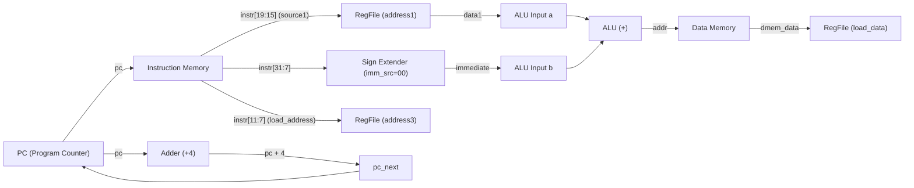
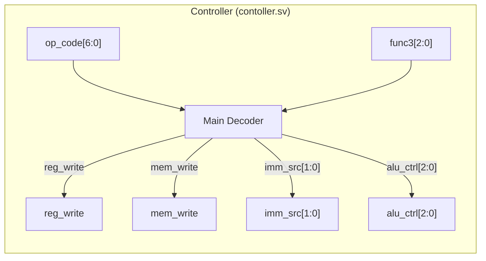
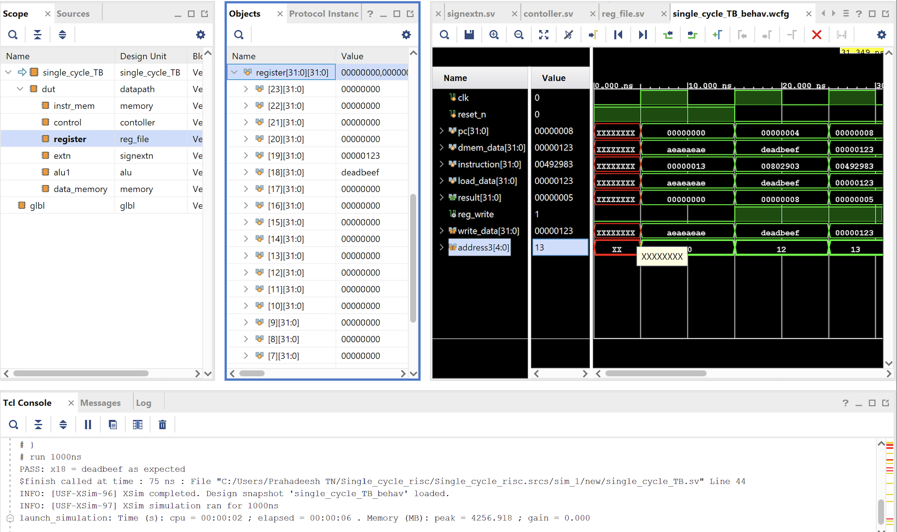
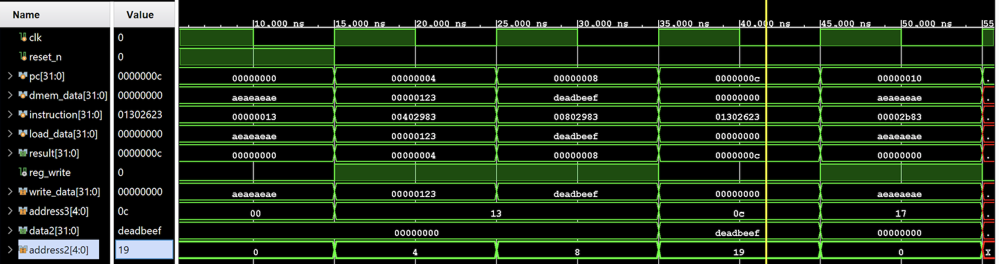
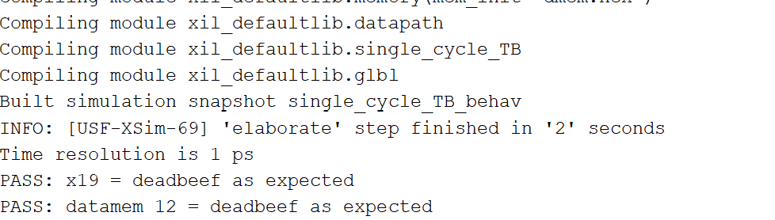
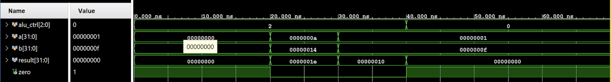
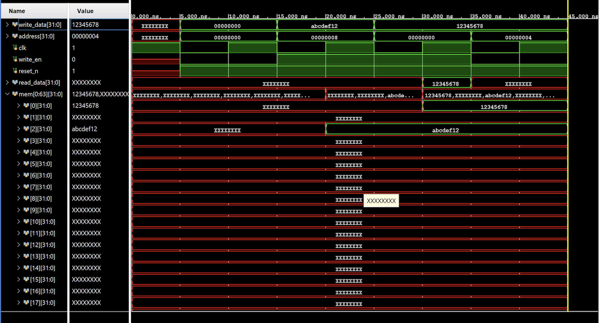

# RM32 — Single-Cycle RISC-V (RV32I Subset) Processor Core

[](https://en.wikipedia.org/wiki/SystemVerilog)
[-orange.svg)](https://riscv.org/)
[](https://www.xilinx.com/products/design-tools/vivado.html)
[]()
[](LICENSE)

---

## 1. Project Overview

**RM32** is a 32-bit single-cycle processor core in SystemVerilog implementing an **RV32I subset** of the open-standard [RISC-V ISA](https://riscv.org/). The core incorporates a program counter, 32×32 register file (`x0` hardwired to zero), ALU with zero flag, immediate sign-extender, opcode/funct-based controller, and separate instruction and data memories.

The processor implements the complete load/store path for Load Word (`lw`) and Store Word (`sw`): I- and S-type immediates, base+offset address generation, register writeback, and memory write-enable. The design is verified in AMD Xilinx Vivado XSim using a self-checking testbench (verifying PASS checks on register `x19` and data-memory writeback), alongside standalone ALU and data-memory simulations.

> [!NOTE]
> **Implementation Scope & Hardware Status**:
> The RTL implements the core memory instructions (`lw`, `sw`). Verification was performed through behavioral simulation in AMD Xilinx Vivado (XSim). The design was **not** implemented on physical FPGA hardware (no FPGA bitstream generation, board testing, or Integrated Logic Analyzer (ILA) validation).

---

## 2. Implementation & Verification Status

The table below summarizes the exact implementation and verification state across the RTL and testbench:

| Instruction | Format | Description | Implemented in RTL | Verified by Testbench | Status / Notes |
|:---|:---:|:---|:---:|:---:|:---|
| **`lw`** | I-Type | Load Word (`lw rd, offset(rs1)`) | **Yes** | **Yes** (XSim PASS) | Base + offset address calculation, loads word from Data Memory to Register File |
| **`sw`** | S-Type | Store Word (`sw rs2, offset(rs1)`) | **Yes** | **Yes** (XSim PASS) | Base + offset address calculation, stores word from Register File to Data Memory |

---

## 3. Microarchitecture Specifications

| Parameter | Specification | Details |
|:---|:---|:---|
| **Architecture** | RISC-V RV32I (Subset) | 32-bit unprivileged base integer instruction set (`lw`, `sw` implemented) |
| **Microarchitecture** | Single-Cycle | 1 CPI (Cycles Per Instruction) for all supported operations |
| **Datapath Width** | 32 bits | 32-bit internal data buses and ALU operands |
| **Address Space** | 32 bits | Word-aligned memory addressing (`address[31:2]`) |
| **Register File** | 32 × 32-bit | Dual asynchronous read ports, single synchronous write port, hardwired zero register (`x0 = 0`) |
| **Memory Model** | Harvard (Split I/D) | Dedicated Instruction Memory and Data Memory with `$readmemh` initialization |
| **Control Unit** | Combinational Decoder | Opcode/funct-based controller asserting `reg_write`, `mem_write`, `imm_src`, and `alu_ctrl` for memory operations |
| **ALU Operations** | 32-bit Addition & Zero Flag | 32-bit addition (effective address calculation `base + imm`) and zero flag detection |
| **Verification Scope** | Behavioral Simulation Only | Simulated in AMD Xilinx Vivado (XSim); no physical FPGA hardware deployment or ILA testing |

---

## 4. Microarchitectural Evolution (Design Progression)

The processor datapath was developed systematically by establishing the core memory access flow:

```
                    ┌────────────────────────────────────────────────────────┐
                    │               Microarchitecture Evolution              │
                    └────────────────────────────────────────────────────────┘
                                                │
                 ┌──────────────────────────────┴──────────────────────────────┐
                 ▼                                                             ▼
       [Stage 1: Base Datapath]                                      [Stage 2: Store Word]
           Load Word (`lw`)                                              Store Word (`sw`)
        • PC + 4 incrementer                                          • Connect RegFile data2 to write_data
        • 12-bit I-type Sign Extension                                • Compute Imm for memory offset
        • ALU addition (Base + Offset)                                • Add S-type Immediate extraction
        • Data Memory read -> RegFile load_data                       • mem_write signal for synchronous store
                 │                                                             │
                 └──────────────────────────────┬──────────────────────────────┘
                                                │
                                      [IMPLEMENTED IN RTL]
```

---

### Stage 1: Base Datapath — Load Word (`lw`)

The foundation of RM32 begins with the **Load Word** instruction (`lw rd, offset(rs1)`), an I-type instruction.

```
Instruction Format (I-Type):
 31                        20 19         15 14    12 11        7 6            0
┌────────────────────────────┬─────────────┬────────┬───────────┬──────────────┐
│         imm[11:0]          │     rs1     │ funct3 │    rd     │    opcode    │
│            -4              │     x9      │  010   │    x6     │   0000011    │
│        111111111100        │    01001    │  010   │   00110   │   0000011    │
└────────────────────────────┴─────────────┴────────┴───────────┴──────────────┘
```

#### Datapath Flow for `lw`:
1. **Instruction Fetch:** The Program Counter (`pc`) outputs the current instruction address to the Instruction Memory. In parallel, an adder computes `pc_next = pc + 4` for sequential execution.
2. **Register Read:** Bits `instruction[19:15]` (`source1`) address read port `address1` of the Register File, yielding base register data `data1`.
3. **Immediate Sign-Extension:** Bits `instruction[31:20]` represent a 12-bit signed immediate (`instr[24:13]` from `instruction[31:7]`). The Sign Extension unit sign-extends this value to a full 32-bit word (`immediate`) matching the ALU operand width.
4. **Address Computation:** The ALU computes the effective memory address:
   $$\text{addr} = \text{data1} + \text{immediate}$$
5. **Memory Access & Writeback:** The computed address indexes the Data Memory (`data_memory`). The read data (`dmem_data`) drives `load_data` into register write port `write_data` addressed by `instruction[11:7]` (`load_address`), latched on the rising clock edge when `reg_write = 1`.



---

### Stage 2: Adding Store Word (`sw`)

To store data into memory, the core implements the **Store Word** instruction (`sw rs2, offset(rs1)`), an S-type instruction.

```
Instruction Format (S-Type):
 31                 25 24         20 19         15 14    12 11         7 6            0
┌─────────────────────┬─────────────┬─────────────┬────────┬────────────┬──────────────┐
│      imm[11:5]      │     rs2     │     rs1     │ funct3 │  imm[4:0]  │    opcode    │
│       0000000       │    00110    │    01001    │  010   │   01000    │   0100011    │
└─────────────────────┴─────────────┴─────────────┴────────┴────────────┴──────────────┘
```

#### Datapath Flow for `sw`:
- **Second Register Read Port:** Bits `instruction[24:20]` (`source2`) route to Register File port `address2` to read the data to be written (`data2`). This connects directly to `write_data` of Data Memory.
- **Immediate Generation (`imm_src`):** S-type instructions split the 12-bit immediate across `instruction[31:25]` and `instruction[11:7]`. The Sign Extension unit supports `imm_src[1:0]`:
  - `imm_src = 2'b00` (I-type): `immediate = {{20{gathered_imm[11]}}, instr[24:13]}`
  - `imm_src = 2'b01` (S-type): `immediate = {{20{gathered_imm[11]}}, instr[24:18], instr[4:0]}`
- **Memory Write Enable (`mem_write`):** Asserted high for store instructions (`op_code = 7'b0100011`) to latch `write_data` (`data2`) into Data Memory at `addr` on the rising clock edge.

---

## 5. Processor Datapath Architecture

The diagram below illustrates the implemented single-cycle datapath architecture for the load/store core:

```
                  ┌────────────────────────────────────────────────────────┐
                  │                 RM32 Implemented Datapath             │
                  └────────────────────────────────────────────────────────┘

    ┌───────────►┌─────────┐
    │            │ ADD (+4)│──────────────┐
    │            └─────────┘              │
    │                                     │
 ┌──┴───┐                                 │
 │  PC  │◄────────────────────────────────┘ pc_next
 └──┬───┘
    │
    ▼
 ┌──────────┐
 │ Inst Mem │ (memory)
 └────┬─────┘
      │
      │   instruction[6:0]
      ├───► [op_code]   Controller
      │   instruction[14:12]   │
      ├───► [func3]            ├──► reg_write
      │                        ├──► mem_write
      │                        ├──► imm_src[1:0]
      │                        └──► alu_ctrl[2:0]
      │
      │   instruction[19:15]
      ├───► [address1]   Register File
      │   instruction[24:20]
      ├───► [address2]      [data1] ──────► [a]   ALU
      │   instruction[11:7]                 │     │
      ├───► [address3]      [data2] ──┐     │     ├──► alu_result (addr)
      │                               │     │     └──► zero
      │   instruction[31:7]           │     ▼
      └───► [instr] Sign Ext ─────────┼───► [b]
                (imm_src)             │
                                      ▼
                                 Data Memory (memory)
                             ┌───────────────────┐
        addr (alu_result) ──►│ address           │
        write_data (data2) ─►│ write_data        │
        mem_write ──────────►│ write_en          │
                             │ read_data         ├──► load_data (write_data)
                             └───────────────────┘    to Register File
```

---

## 6. Control Unit Architecture & Truth Tables

The controller (`contoller.sv`) decodes the instruction opcode for single-cycle execution:



### Main Decoder Truth Table

| Instruction | Opcode (`op_code[6:0]`) | `reg_write` | `mem_write` | `imm_src[1:0]` | `alu_ctrl[2:0]` | ALU Operation |
|:---|:---:|:---:|:---:|:---:|:---:|:---|
| **`lw`** | `7'b0000011` | `1` | `0` | `2'b00` (I-type) | `3'b010` | Addition (Base + Offset) |
| **`sw`** | `7'b0100011` | `0` | `1` | `2'b01` (S-type) | `3'b010` | Addition (Base + Offset) |
| *Default / Other* | *default* | `0` | `0` | `2'b00` | `3'b010` | Addition |

---

## 7. Deep Inside the ALU

In the synthesizable RTL ([`rtl/alu.sv`](rtl/alu.sv)), the ALU implements the 32-bit addition operation required for load/store effective address calculation (`base + immediate`) alongside zero flag detection:

```systemverilog
always_comb begin
    case(alu_ctrl)
        3'b010 : result = a + b;
        default : result = 0;
    endcase   
end
assign zero = (result == 32'b0);
```

The zero flag indicates whether `result == 32'b0`, providing zero detection output alongside the address computation.

---

## 8. RTL Implementation Directory & Module Guide

The repository is structured into modular SystemVerilog source files:

```
rm32/
├── README.md                      # Processor microarchitecture documentation
├── LICENSE                        # MIT License
├── .gitignore                     # Git tracking exclusions
├── images/                        # Simulation waveforms and verification artifacts
│   ├── alu_add_verification.png   # ALU adder unit simulation waveform
│   ├── Dmem_verification.png      # Data memory unit simulation waveform
│   ├── load_better.png            # Vivado load word verification waveform
│   ├── lw_sw_sim.png              # Load & Store program execution waveform
│   └── tcl_console_lw_sw.png      # Vivado TCL console automated test output
├── rtl/                           # Synthesizable SystemVerilog source files
│   ├── alu.sv                     # 32-bit Arithmetic Logic Unit (Addition & Zero flag)
│   ├── contoller.sv               # Instruction decoder and controller for lw / sw
│   ├── datapath.sv                # Top-level single-cycle processor datapath
│   ├── dmem.sv                    # Parameterized synchronous write / combinational read memory
│   ├── imem.sv                    # Instruction memory interface wrapper
│   ├── reg_file.sv                # 32 x 32-bit dual-read register file (x0 = 0)
│   ├── signextn.sv                # Immediate sign extension (I-type & S-type)
│   ├── dmem.hex                   # Initial data memory contents
│   └── imemory.hex                # Assembled machine code test program
└── TestBench/
    └── single_cycle_TB.sv         # Self-checking simulation testbench
```

### RTL Module Summaries

- **[`rtl/datapath.sv`](rtl/datapath.sv):** Instantiates and interconnects the Program Counter register, Instruction Memory, Controller, Register File, Sign Extender, ALU, and Data Memory for single-cycle execution of `lw` and `sw`.
- **[`rtl/contoller.sv`](rtl/contoller.sv):** Decodes instruction opcode (`op_code[6:0]`) for `lw` (`7'b0000011`) and `sw` (`7'b0100011`), asserting `reg_write`, `mem_write`, `imm_src`, and `alu_ctrl`.
- **[`rtl/alu.sv`](rtl/alu.sv):** Performs 32-bit arithmetic addition (`result = a + b`) for memory address generation and computes the `zero` flag.
- **[`rtl/reg_file.sv`](rtl/reg_file.sv):** Implements thirty-two 32-bit registers. Features asynchronous dual read (`data1`, `data2`), synchronous write on `clk` posedge with write-enable gate, and guarantees `register[0]` remains hardwired to zero.
- **[`rtl/signextn.sv`](rtl/signextn.sv):** Assembles and sign-extends 12-bit immediate offsets based on `imm_source`:
  - `2'b00` (I-type): `{instr[24:13]}` $\rightarrow$ sign-extended to 32 bits.
  - `2'b01` (S-type): `{instr[24:18], instr[4:0]}` $\rightarrow$ sign-extended to 32 bits.
- **[`rtl/dmem.sv`](rtl/dmem.sv):** 64-word parameterized `memory` module initialized from a `.hex` file. Writes occur synchronously on `clk` posedge when word-aligned (`address[1:0] == 2'b00`), while reads occur combinationally.
- **[`rtl/imem.sv`](rtl/imem.sv):** Instruction memory interface wrapper (the active datapath directly instantiates the parameterized `memory` module from `dmem.sv` pre-loaded with `imemory.hex`).

---

## 9. Verification & Simulation Results

The core has been validated using **AMD Xilinx Vivado (XSim)** behavioral simulation with self-checking testbenches and automated assertions.

> [!IMPORTANT]
> **Behavioral Simulation Only**:
> All verification reported in this repository was performed strictly through behavioral RTL simulation in AMD Xilinx Vivado XSim. The design has **not** been synthesized, place-and-routed, or validated on physical FPGA development boards (e.g. Artix-7 or Basys3), and no hardware logic analyzers (ILA) were used.

### 1. Test Program Assembly

The instruction memory is pre-loaded via [`rtl/imemory.hex`](rtl/imemory.hex) with a verification program:

```assembly
# Address   Machine Code   Instruction          Description
0x00000000  00000013       nop                  addi x0, x0, 0 (default controller nop)
0x00000004  00402983       lw x19, 4(x0)        Load word from dmem[1] (0x00000123) into x19
0x00000008  00802983       lw x19, 8(x0)        Load word from dmem[2] (0xDEADBEEF) into x19
0x0000000C  01302623       sw x19, 12(x0)       Store word (0xDEADBEEF) into dmem[3]
0x00000010  00002b83       lw x23, 0(x0)        Load word from dmem[0] (0xAEAEAEAE) into x23
```

Initial Data Memory ([`rtl/dmem.hex`](rtl/dmem.hex)):
```hex
AEAEAEAE  // @ 0x00000000 (byte offset 0)
00000123  // @ 0x00000004 (byte offset 4)
DEADBEEF  // @ 0x00000008 (byte offset 8)
00000000  // @ 0x0000000C (byte offset 12, store word destination)
```

---

### 2. Load Word (`lw`) Execution Verification

The waveform below demonstrates the execution of the memory load instructions:
- Cycle 1: `lw x19, 4(x0)` loads `0x00000123` into register `x19`.
- Cycle 2: `lw x19, 8(x0)` updates register `x19` with `0xDEADBEEF`.



---

### 3. Combined Load & Store (`lw` + `sw`) Execution Verification

The waveform confirms proper dataflow between the Register File and Data Memory:
- Register `x19` holds `0xDEADBEEF`.
- On instruction `0x01302623` (`sw x19, 12(x0)`), `write_data` is driven as `0xDEADBEEF` to address `0x0000000C` (`mem[3]`).
- On the next cycle, memory location offset 12 reflects `0xDEADBEEF`.



---

### 4. Automated Self-Checking Testbench Output

The Vivado TCL simulation console verifies the hardware assertions written in [`TestBench/single_cycle_TB.sv`](TestBench/single_cycle_TB.sv):

```text
Compiling module xil_defaultlib.memory(mem_init="dmem.hex")
Compiling module xil_defaultlib.datapath
Compiling module xil_defaultlib.single_cycle_TB
Compiling module xil_defaultlib.glbl
Built simulation snapshot single_cycle_TB_behav
INFO: [USF-XSim-69] 'elaborate' step finished in '2' seconds
Time resolution is 1 ps
PASS: x19 = deadbeef as expected
PASS: datamem 12 = deadbeef as expected
$finish called at time : 75 ns
```



---

### 5. Unit Verification: ALU & Data Memory

Individual unit-level simulations confirm functional correctness before system integration:

| ALU Adder & Zero Verification | Data Memory Synchronous Write / Combinational Read |
|:---:|:---:|
|  |  |

---

## 10. How to Simulate

### Prerequisites
- **AMD Xilinx Vivado** (v2020.1 or newer recommended) or any IEEE 1800-2017 compliant SystemVerilog simulator (e.g., ModelSim, Questa, Verilator, Icarus Verilog).

### Running Behavioral Simulation in Vivado GUI
1. Clone the repository:
   ```bash
   git clone https://github.com/nikunjmalik306/rm32.git
   cd rm32
   ```
2. Create a new Vivado project for RTL simulation.
3. Add design sources from `rtl/`:
   - `datapath.sv`, `contoller.sv`, `alu.sv`, `reg_file.sv`, `signextn.sv`, `dmem.sv`, `imem.sv`
   - Memory hex files: `imemory.hex`, `dmem.hex`
4. Add simulation source from `TestBench/`:
   - `single_cycle_TB.sv`
5. Run Behavioral Simulation (**Run Simulation $\rightarrow$ Run Behavioral Simulation**).
6. Verify console output reports:
   ```
   PASS: x19 = deadbeef as expected
   PASS: datamem 12 = deadbeef as expected
   ```

---

## 11. References

1. **RISC-V ISA Specification** — *The RISC-V Instruction Set Manual, Volume I: Unprivileged ISA*, Version 20191213. RISC-V International. [https://riscv.org/technical/specifications/](https://riscv.org/technical/specifications/)
2. **Harris & Harris** — *Digital Design and Computer Architecture: RISC-V Edition*. Sarah L. Harris and David Money Harris, Morgan Kaufmann, 2021.
3. **IEEE Standard 1800-2017** — *IEEE Standard for SystemVerilog — Unified Hardware Design, Specification, and Verification Language*.

---

<p align="center">
  <b>RM32 Processor Core</b> • Developed by <a href="https://github.com/nikunjmalik306">Nikunj Malik</a>
</p>
