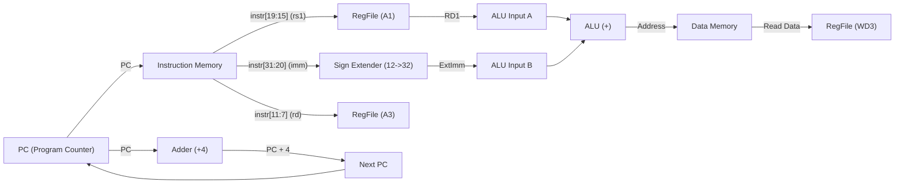
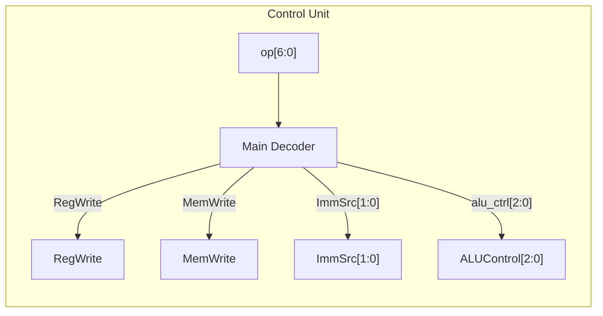

# RM32 — Single-Cycle 32-bit RISC-V (RV32I) Processor Core

[](https://en.wikipedia.org/wiki/SystemVerilog)
[-orange.svg)](https://riscv.org/)
[](https://www.xilinx.com/products/design-tools/vivado.html)
[]()
[](LICENSE)

---

## 1. Project Overview

**RM32** is a single-cycle 32-bit processor core implementing a foundational subset of the **RV32I** base integer instruction set of the open-standard [RISC-V ISA](https://riscv.org/). Written in modular **SystemVerilog**, the core executes an instruction every clock cycle using a combinational datapath orchestrated by a centralized control unit.

The processor was developed through **first-principles incremental microarchitecture evolution**: establishing an operational baseline capable of memory operations—Load Word (`lw`) and Store Word (`sw`)—with self-checking behavioral simulation in AMD Xilinx Vivado XSim. The microarchitectural roadmap plans the subsequent datapath extensions, multiplexers, control signals, immediate decoders, arithmetic units, and branch structures required to support R-type arithmetic/logic (`add`, `sub`, `and`, `or`, `slt`) and conditional branches (`beq`).

> [!NOTE]
> **Implementation Scope & Hardware Status**:
> The RTL currently implements and verifies the core memory instructions (`lw`, `sw`). Verification was performed strictly through behavioral simulation in AMD Xilinx Vivado (XSim). The design was **not** implemented on physical FPGA hardware (no FPGA bitstream generation, board testing, or Integrated Logic Analyzer (ILA) validation).

---

## 2. Implementation & Verification Status

The table below summarizes the exact implementation and verification state of each instruction across the RTL and testbench:

| Instruction | Format | Description | Implemented in RTL | Verified by Testbench | Status / Notes |
|:---|:---:|:---|:---:|:---:|:---|
| **`lw`** | I-Type | Load Word (`lw rd, offset(rs1)`) | **Yes** | **Yes** (XSim PASS) | Base + offset address calculation, loads word from Data Memory to Register File |
| **`sw`** | S-Type | Store Word (`sw rs2, offset(rs1)`) | **Yes** | **Yes** (XSim PASS) | Base + offset address calculation, stores word from Register File to Data Memory |
| **`add`** | R-Type | Add (`add rd, rs1, rs2`) | *Planned* | *No* | Requires ResultSrc mux (ALU vs DMem), ALUSrc mux, and full ALUOp decode |
| **`sub`** | R-Type | Subtract (`sub rd, rs1, rs2`) | *Planned* | *No* | Requires ALU subtractor logic and ALUOp decode |
| **`and`** | R-Type | Bitwise AND (`and rd, rs1, rs2`) | *Planned* | *No* | Requires bitwise AND in ALU and ALUOp decode |
| **`or`** | R-Type | Bitwise OR (`or rd, rs1, rs2`) | *Planned* | *No* | Requires bitwise OR in ALU and ALUOp decode |
| **`slt`** | R-Type | Set Less Than (`slt rd, rs1, rs2`) | *Planned* | *No* | Requires signed comparison in ALU and ALUOp decode |
| **`beq`** | B-Type | Branch if Equal (`beq rs1, rs2, offset`) | *Planned* | *No* | Requires branch target adder, PCSrc mux, and zero flag branch gating |

---

## 3. Microarchitecture Specifications

| Parameter | Specification | Details |
|:---|:---|:---|
| **Architecture** | RISC-V RV32I (Subset) | 32-bit unprivileged base integer instruction set (`lw`, `sw` implemented; R-type and branch planned) |
| **Microarchitecture** | Single-Cycle | 1 CPI (Cycles Per Instruction) for all supported operations |
| **Datapath Width** | 32 bits | 32-bit internal data buses and ALU operands |
| **Address Space** | 32 bits | Word-aligned memory addressing (`address[31:2]`) |
| **Register File** | 32 × 32-bit | Dual asynchronous read ports, single synchronous write port, hardwired zero register (`x0 = 0`) |
| **Memory Model** | Harvard (Split I/D) | Dedicated Instruction Memory and Data Memory with `$readmemh` initialization |
| **Control Unit** | Combinational Decoder | Opcode-driven decoder asserting `reg_write`, `mem_write`, `imm_src`, and `alu_ctrl` for memory operations |
| **ALU Operations** | 32-bit Addition & Zero Flag | 32-bit addition (effective address calculation `base + imm`) and zero flag detection |
| **Verification Scope** | Behavioral Simulation Only | Simulated in AMD Xilinx Vivado (XSim); no physical FPGA hardware deployment or ILA testing |

---

## 4. Microarchitectural Evolution (Design Progression)

The processor was developed systematically by analyzing the datapath requirements one instruction family at a time:

```
                    ┌────────────────────────────────────────────────────────┐
                    │               Microarchitecture Evolution              │
                    └────────────────────────────────────────────────────────┘
                                                │
                 ┌──────────────────────────────┴──────────────────────────────┐
                 ▼                                                             ▼
       [Stage 1: Base Datapath]                                      [Stage 2: Store Word]
           Load Word (`lw`)                                              Store Word (`sw`)
        • PC + 4 incrementer                                          • Connect RegFile RD2
        • 12-bit I-type Sign Extension                                • ALUSrc selects Imm for memory offset
        • ALU addition (Base + Offset)                                • Add S-type Immediate extraction
        • Data Memory read -> RegFile WD3                             • MemWrite signal for synchronous store
                 │                                                             │
                 │                     [IMPLEMENTED IN RTL]                    │
                 └──────────────────────────────┬──────────────────────────────┘
                                                │
                 ┌──────────────────────────────┴──────────────────────────────┐
                 ▼                                                             ▼
     [Stage 3: Planned R-Type]                                     [Stage 4: Planned Branch]
 `add`, `sub`, `and`, `or`, `slt`                                              `beq`
        • Add ResultSrc Mux (ALU vs DMem)                             • Add Branch Target Adder (PC + Imm)
        • ALU direct feed to Register File                            • ALU Subtraction with Zero Flag
        • 3-bit ALUControl decoding                                   • PCSrc Logic: Branch & Zero
        • Multi-op ALU Arithmetic/Logic core                          • Add Next-PC Selection Mux
```

---

### Stage 1: Base Datapath — Load Word (`lw`) [Implemented]

The foundation of RM32 begins with the **Load Word** instruction (`lw rd, offset(rs1)`), an I-type instruction.

```
Instruction Format (I-Type):
 31                        20 19         15 14    12 11        7 6            0
┌────────────────────────────┬─────────────┬────────┬───────────┬──────────────┐
│         imm[11:0]          │     rs1     │ funct3 │    rd     │    opcode    │
│            -4              │     x9      │  010   │    x6     │   0000011    │
│        111111111100        │    01001    │  010   │   00110   │   0000011    │
└────────────────────────────┴─────────────┴────────┴───────────┴──────────────┘
```

#### Datapath Flow for `lw`:
1. **Instruction Fetch:** The Program Counter (`PC`) outputs the current instruction address to the Instruction Memory. In parallel, an adder computes `PC + 4` for sequential execution.
2. **Register Read:** Bits `instruction[19:15]` (`rs1`) address read port `A1` of the Register File, yielding base register data `RD1`.
3. **Immediate Sign-Extension:** Bits `instruction[31:20]` (`imm[11:0]`) represent a 12-bit signed immediate. The Sign Extension unit sign-extends this value to a full 32-bit word to match the ALU operand width.
4. **Address Computation:** The ALU computes the effective memory address:
   $$\text{Address} = \text{RD1} + \text{SignExt}(\text{imm})$$
5. **Memory Access & Writeback:** The computed address indexes the Data Memory (`dmem`). The read data (`dmem_data`) is driven into register write port `WD3`, addressed by `instruction[11:7]` (`rd`), where it is latched on the rising clock edge when `RegWrite = 1`.



---

### Stage 2: Adding Store Word (`sw`) [Implemented]

To store data back into memory, the core adds the **Store Word** instruction (`sw rs2, offset(rs1)`), an S-type instruction.

```
Instruction Format (S-Type):
 31                 25 24         20 19         15 14    12 11         7 6            0
┌─────────────────────┬─────────────┬─────────────┬────────┬────────────┬──────────────┐
│      imm[11:5]      │     rs2     │     rs1     │ funct3 │  imm[4:0]  │    opcode    │
│       0000000       │    00110    │    01001    │  010   │   01000    │   0100011    │
└─────────────────────┬─────────────┬─────────────┬────────┬────────────┴──────────────┘
```

#### Datapath Flow for `sw`:
- **Second Register Read Port (`RD2`):** Bits `instruction[24:20]` (`rs2`) route to Register File port `A2` to read the data to be written (`RD2`). This signal directly connects to `write_data` of Data Memory.
- **Immediate Generation (`ImmSrc`):** S-type instructions split the 12-bit immediate across `instruction[31:25]` and `instruction[11:7]`. The Sign Extension unit supports `ImmSrc[1:0]`:
  - `ImmSrc = 2'b00` (I-type): Imm = `{{20{instr[31]}}, instr[31:20]}`
  - `ImmSrc = 2'b01` (S-type): Imm = `{{20{instr[31]}}, instr[31:25], instr[11:7]}`
- **Memory Write Enable (`MemWrite`):** Asserted high exclusively for store instructions (`opcode = 7'b0100011`) to latch `RD2` into Data Memory at the target address on the rising clock edge.

---

### Stage 3: Extending to R-Type Operations [Planned Architecture]

R-type instructions operate strictly between registers without memory access.

```
Instruction Format (R-Type):
 31                 25 24         20 19         15 14    12 11        7 6            0
┌─────────────────────┬─────────────┬─────────────┬────────┬───────────┬──────────────┐
│       funct7        │     rs2     │     rs1     │ funct3 │    rd     │    opcode    │
│      0000000        │    00110    │    00101    │  110   │   00100   │   0110011    │
└─────────────────────┴─────────────┴─────────────┴────────┴───────────┴──────────────┘
 Example: or x4, x5, x6
```

#### Required Datapath Additions for R-Type:
- **`ResultSrc` Multiplexer:** A multiplexer at the writeback stage allowing the register file write data port (`WD3`) to select between:
  - `ResultSrc = 0`: `ALUResult` (for R-type instructions)
  - `ResultSrc = 1`: `ReadData` from Data Memory (for `lw`)
- **`ALUSrc` Multiplexer:** Selects between `RD2` (for R-type) and `SignExt(Imm)` (for memory address offset).
- **ALU Function Expansion:** Multi-operation ALU supporting addition, subtraction, AND, OR, and SLT.

---

### Stage 4: Adding Conditional Branching (`beq`) [Planned Architecture]

Branch instructions alter sequential program execution based on comparison.

```
Instruction Format (B-Type):
 31   30           25 24         20 19         15 14    12 11        8  7   6            0
┌────┬───────────────┬─────────────┬─────────────┬────────┬───────────┬───┬──────────────┐
│12  │   imm[10:5]   │     rs2     │     rs1     │ funct3 │ imm[4:1]  │11 │    opcode    │
│ 1  │    111111     │    00100    │    00100    │  000   │   1010    │ 1 │   1100011    │
└────┴───────────────┴─────────────┴─────────────┴────────┴───────────┴───┴──────────────┘
 Example: beq x4, x4, L7
```

#### Required Datapath Additions for `beq`:
- **Branch Target Adder:** A dedicated 32-bit adder computing `PCTarget = PC + SignExt(imm_B)`.
- **Zero Flag Evaluation:** ALU subtraction (`RD1 - RD2`) with `Zero` flag asserted when operands are equal.
- **PCSrc Branch Logic:** `PCSrc = Branch & Zero` driving a 2-to-1 multiplexer to choose between `PC + 4` and `PCTarget`.

---

## 5. Comprehensive Processor Datapath Architecture

The diagram below illustrates the complete single-cycle datapath architecture incorporating both the implemented memory instructions and the planned R-type / branch paths:

```
                  ┌────────────────────────────────────────────────────────┐
                  │                 RM32 Unified Datapath                  │
                  └────────────────────────────────────────────────────────┘

              ┌──────────────────────────────────────────────┐
              │                                              │
              ▼                                              │
         ┌─────────┐                                         │
         │  MUX    │◄─── PCSrc (Branch & Zero) [Planned]     │
         └──┬───┬──┘                                         │
     PC+4   │   │ PCTarget                                   │
      ┌─────┘   └──────┐                                     │
      ▼                ▼                                     │
   ┌──────┐         ┌──────┐                                 │
   │  PC  │────────►│ ADD  │ (PC + SignExt(Imm)) [Planned]   │
   └──┬───┘         └──┬───┘                                 │
      │                └─────────────────────────────────────┘
      ├───────────►┌─────────┐
      │            │ ADD (+4)│──────────────┐
      │            └─────────┘              │
      ▼                                     ▼
 ┌──────────┐                          ┌─────────┐
 │ Inst Mem │                          │ MUX     │◄── ResultSrc [Planned]
 └────┬─────┘                          └──┬───┬──┘
      │                                   │   │
      │   instr[19:15] (rs1)              │   │ ReadData
      ├───► [A1]   Register File          │   └──────────────┐
      │   instr[24:20] (rs2)              │ ALUResult        │
      ├───► [A2]      [RD1] ──────► [A]   │                  │
      │   instr[11:7] (rd)                ▼                  │
      ├───► [A3]      [RD2] ──┬───► [0]  ALU ───► Result ────┤
      │                       │     [MUX]                    │
      │                       └───► [1]   │ (ALUSrc)         │
      │                             ▲     └──► Zero ─┐       │
      │   instr[31:7]               │                │       │
      └───► [Sign Ext] ─────────────┘                │       │
                  │                                  ▼       │
                  └───────────────────────────► [PCSrc Logic]│
                                                     ▲       │
                                                     │       │
                               Data Memory           │       │
                            ┌──────────────┐         │       │
       ALU Result ─────────►│ Address      │         │       │
       RD2 (WriteData) ────►│ Write Data   │         │       │
       MemWrite ───────────►│ Write Enable │         │       │
                            │ Read Data    ├─────────┴───────┘
                            └──────────────┘
```

*Note: In the current baseline RTL, the datapath executes `pc_next = pc + 4`, `load_data = dmem_data`, and `alu_input2 = immediate`, matching the dedicated memory subsystem flow.*

---

## 6. Control Unit Architecture & Truth Tables

The control unit is organized around instruction decoding for single-cycle execution:



### Main Decoder Truth Table

| Instruction | Opcode (`op[6:0]`) | RegWrite | ImmSrc | ALUSrc | MemWrite | ResultSrc | Branch | ALUOp | ALU Operation | Implementation Status |
|:---|:---:|:---:|:---:|:---:|:---:|:---:|:---:|:---:|:---|:---:|
| **`lw`** | `7'b0000011` | `1` | `00` (I) | `1` | `0` | `1` (DMem) | `0` | `2'b00` | Addition (Base + Offset) | **Implemented** |
| **`sw`** | `7'b0100011` | `0` | `01` (S) | `1` | `1` | `X` | `0` | `2'b00` | Addition (Base + Offset) | **Implemented** |
| **R-Type** | `7'b0110011` | `1` | `XX` | `0` | `0` | `0` (ALU) | `0` | `2'b10` | Determined by `funct3` / `funct7` | *Planned* |
| **`beq`** | `7'b1100011` | `0` | `10` (B) | `0` | `0` | `X` | `1` | `2'b01` | Subtraction (Compare `rs1 == rs2`) | *Planned* |

### ALU Decoder Mapping

| `ALUOp[1:0]` | `funct3[2:0]` | `funct7[5]` | `alu_ctrl[2:0]` | Operation | Status in RTL |
|:---:|:---:|:---:|:---:|:---|:---:|
| `2'b00` | `XXX` | `X` | `3'b010` | **Add** (address calculation for `lw`/`sw`) | **Implemented** |
| `2'b01` | `XXX` | `X` | `3'b001` | **Subtract** (equality comparison for `beq`) | *Planned* |
| `2'b10` | `3'b000` | `1'b0` | `3'b000` | **Add** (`add`) | *Planned* |
| `2'b10` | `3'b000` | `1'b1` | `3'b001` | **Subtract** (`sub`) | *Planned* |
| `2'b10` | `3'b010` | `1'b0` | `3'b101` | **Set Less Than** (`slt`) | *Planned* |
| `2'b10` | `3'b110` | `1'b0` | `3'b011` | **Bitwise OR** (`or`) | *Planned* |
| `2'b10` | `3'b111` | `1'b0` | `3'b010` | **Bitwise AND** (`and`) | *Planned* |

---

## 7. Deep Inside the ALU

In the current synthesizable RTL ([`rtl/alu.sv`](rtl/alu.sv)), the ALU implements the 32-bit addition operation required for load/store effective address calculation (`base + immediate`) alongside zero flag detection:

```systemverilog
always_comb begin
    case(alu_ctrl)
        3'b010 : result = a + b;
        default : result = 0;
    endcase   
end
assign zero = (result == 32'b0);
```

The multi-function ALU structure below outlines the planned microarchitecture expansion for R-type execution:

```
                    ┌──────────────────────────────────────────────┐
                    │       Multi-Function ALU (Planned Extension) │
                    └──────────────────────────────────────────────┘

                                   A [31:0]           B [31:0]
                                      │                  │
                         ┌────────────┼───────────┬──────┼────────┐
                         │            │           │      ▼        │
                         │            │           │   ┌──────┐    │
                         │            │           │   │ NOT  │    │
                         │            │           │   └──┬───┘    │
                         │            │           │      │        │
                         │            │           │  [0] │ [1]    │
                         │            │           ├──►\  /        │
                         │            │           │    \/ MUX     │
                         │            │           │    │◄── alu_ctrl[0] (Invert B)
                         │            │           │    │
                         ▼            ▼           │    │
                      ┌─────┐      ┌─────┐        │    │
                      │ AND │      │ OR  │        │    │
                      └──┬──┘      └──┬──┘        ▼    ▼
                         │            │        ┌──────────┐
                         │            │        │  ADDER   │◄── Cin = alu_ctrl[0]
                         │            │        └──┬────┬──┘
                         │            │           │    │ Cout/Sign
                         │            │           │    ▼
                         │            │           │ ┌───────────────┐
                         │            │           │ │ Zero-Extend   │ (Set Less Than)
                         │            │           │ └───────┬───────┘
                         │            │           │         │
                         ▼            ▼           ▼         ▼
                      ┌─────────────────────────────────────────┐
                      │              OUTPUT MUX                 │◄── alu_ctrl[2:0]
                      └────────────────────┬────────────────────┘
                                           │
                                           ├───────────────► Result [31:0]
                                           ▼
                                    ┌──────────────┐
                                    │ NOR REDUCTION│───────► Zero Flag
                                    └──────────────┘
```

---

## 8. RTL Implementation Directory & Module Guide

The repository is structured into modular SystemVerilog source files:

```
rm32/
├── README.md                      # Comprehensive microarchitecture documentation
├── .gitignore                     # Git tracking exclusions
├── images/                        # Simulation waveforms and verification artifacts
│   ├── alu_add_verification.png   # ALU adder unit simulation waveform
│   ├── Dmem_verification.png      # Data memory unit simulation waveform
│   ├── load_better.png            # Vivado load word verification waveform
│   ├── lw_sw_sim.png              # Load & Store program execution waveform
│   └── tcl_console_lw_sw.png      # Vivado TCL console automated test output
├── rtl/                           # Synthesizable SystemVerilog source files
│   ├── alu.sv                     # 32-bit Arithmetic Logic Unit (Addition & Zero flag)
│   ├── contoller.sv               # Instruction decoder and controller for lw / sw
│   ├── datapath.sv                # Top-level single-cycle processor datapath
│   ├── dmem.sv                    # Parameterized synchronous write / combinational read memory
│   ├── imem.sv                    # Instruction memory interface wrapper
│   ├── reg_file.sv                # 32 x 32-bit dual-read register file (x0 = 0)
│   ├── signextn.sv                # Immediate sign extension (I-type & S-type)
│   ├── dmem.hex                   # Initial data memory contents
│   └── imemory.hex                # Assembled machine code test program
└── TestBench/
    └── single_cycle_TB.sv         # Self-checking simulation testbench
```

### RTL Module Summaries

- **[`rtl/datapath.sv`](rtl/datapath.sv):** Instantiates and interconnects the Program Counter register, Instruction Memory, Controller, Register File, Sign Extender, ALU, and Data Memory for single-cycle execution of `lw` and `sw`.
- **[`rtl/contoller.sv`](rtl/contoller.sv):** Decodes instruction opcode (`instruction[6:0]`) for `lw` (`7'b0000011`) and `sw` (`7'b0100011`), asserting `reg_write`, `mem_write`, `imm_src`, and `alu_ctrl`.
- **[`rtl/alu.sv`](rtl/alu.sv):** Performs 32-bit arithmetic addition (`result = a + b`) for memory address generation and computes the `zero` flag.
- **[`rtl/reg_file.sv`](rtl/reg_file.sv):** Implements thirty-two 32-bit registers. Features asynchronous dual read (`data1`, `data2`), synchronous write on `clk` posedge with write-enable gate, and guarantees `register[0]` remains hardwired to zero.
- **[`rtl/signextn.sv`](rtl/signextn.sv):** Assembles and sign-extends 12-bit immediate offsets based on `imm_source`:
  - `2'b00` (I-type): `{instr[24:13]}` $\rightarrow$ sign-extended to 32 bits.
  - `2'b01` (S-type): `{instr[24:18], instr[4:0]}` $\rightarrow$ sign-extended to 32 bits.
- **[`rtl/dmem.sv`](rtl/dmem.sv):** 64-word memory block initialized from a `.hex` file. Writes occur synchronously on `clk` posedge when word-aligned (`address[1:0] == 2'b00`), while reads occur combinationally.
- **[`rtl/imem.sv`](rtl/imem.sv):** Instruction memory interface wrapper (the active datapath directly instantiates the parameterized `memory` module from `dmem.sv` pre-loaded with `imemory.hex`).

---

## 9. Verification & Simulation Results

The core has been validated using **AMD Xilinx Vivado (XSim)** behavioral simulation with self-checking testbenches and automated assertions.

> [!IMPORTANT]
> **Behavioral Simulation Only**:
> All verification reported in this repository was performed strictly through behavioral RTL simulation in AMD Xilinx Vivado XSim. The design has **not** been synthesized, place-and-routed, or validated on physical FPGA development boards (e.g. Artix-7 or Basys3), and no hardware logic analyzers (ILA) were used.

### 1. Test Program Assembly

The instruction memory is pre-loaded via [`rtl/imemory.hex`](rtl/imemory.hex) with a verification program:

```assembly
# Address   Machine Code   Instruction          Description
0x00000000  00000013       nop                  addi x0, x0, 0 (default controller nop)
0x00000004  00402983       lw x19, 4(x0)        Load word from dmem[1] (0x00000123) into x19
0x00000008  00802983       lw x19, 8(x0)        Load word from dmem[2] (0xDEADBEEF) into x19
0x0000000C  01302623       sw x19, 12(x0)       Store word (0xDEADBEEF) into dmem[3]
0x00000010  00002b83       lw x23, 0(x0)        Load word from dmem[0] (0xAEAEAEAE) into x23
```

Initial Data Memory ([`rtl/dmem.hex`](rtl/dmem.hex)):
```hex
AEAEAEAE  // @ 0x00000000 (byte offset 0)
00000123  // @ 0x00000004 (byte offset 4)
DEADBEEF  // @ 0x00000008 (byte offset 8)
00000000  // @ 0x0000000C (byte offset 12, store word destination)
```

---

### 2. Load Word (`lw`) Execution Verification

The waveform below demonstrates the execution of the memory load instructions:
- Cycle 1: `lw x19, 4(x0)` loads `0x00000123` into register `x19`.
- Cycle 2: `lw x19, 8(x0)` updates register `x19` with `0xDEADBEEF`.


---

### 3. Combined Load & Store (`lw` + `sw`) Execution Verification

The waveform confirms proper dataflow between the Register File and Data Memory:
- Register `x19` holds `0xDEADBEEF`.
- On instruction `0x01302623` (`sw x19, 12(x0)`), `write_data` is driven as `0xDEADBEEF` to address `0x0000000C` (`mem[3]`).
- On the next cycle, memory location offset 12 reflects `0xDEADBEEF`.


---

### 4. Automated Self-Checking Testbench Output

The Vivado TCL simulation console verifies the hardware assertions written in [`TestBench/single_cycle_TB.sv`](TestBench/single_cycle_TB.sv):

```text
Compiling module xil_defaultlib.memory(mem_init="dmem.hex")
Compiling module xil_defaultlib.datapath
Compiling module xil_defaultlib.single_cycle_TB
Compiling module xil_defaultlib.glbl
Built simulation snapshot single_cycle_TB_behav
INFO: [USF-XSim-69] 'elaborate' step finished in '2' seconds
Time resolution is 1 ps
PASS: x19 = deadbeef as expected
PASS: datamem 12 = deadbeef as expected
$finish called at time : 75 ns
```


---

### 5. Unit Verification: ALU & Data Memory

Individual unit-level simulations confirm functional correctness before system integration:

| ALU Adder & Zero Verification | Data Memory Synchronous Write / Combinational Read |
|:---:|:---:|
|  |  |

---

## 10. How to Simulate

### Prerequisites
- **AMD Xilinx Vivado** (v2020.1 or newer recommended) or any IEEE 1800-2017 compliant SystemVerilog simulator (e.g., ModelSim, Questa, Verilator, Icarus Verilog).

### Running Behavioral Simulation in Vivado GUI
1. Clone the repository:
   ```bash
   git clone https://github.com/nikunjmalik306/rm32.git
   cd rm32
   ```
2. Create a new Vivado project for RTL simulation.
3. Add design sources from `rtl/`:
   - `datapath.sv`, `contoller.sv`, `alu.sv`, `reg_file.sv`, `signextn.sv`, `dmem.sv`, `imem.sv`
   - Memory hex files: `imemory.hex`, `dmem.hex`
4. Add simulation source from `TestBench/`:
   - `single_cycle_TB.sv`
5. Run Behavioral Simulation (**Run Simulation $\rightarrow$ Run Behavioral Simulation**).
6. Verify console output reports:
   ```
   PASS: x19 = deadbeef as expected
   PASS: datamem 12 = deadbeef as expected
   ```

---

## 11. References

1. **RISC-V ISA Specification** — *The RISC-V Instruction Set Manual, Volume I: Unprivileged ISA*, Version 20191213. RISC-V International. [https://riscv.org/technical/specifications/](https://riscv.org/technical/specifications/)
2. **Harris & Harris** — *Digital Design and Computer Architecture: RISC-V Edition*. Sarah L. Harris and David Money Harris, Morgan Kaufmann, 2021.
3. **IEEE Standard 1800-2017** — *IEEE Standard for SystemVerilog — Unified Hardware Design, Specification, and Verification Language*.

---

<p align="center">
  <b>RM32 Processor Core</b> • Developed by <a href="https://github.com/nikunjmalik306">Nikunj Malik</a>
</p>
